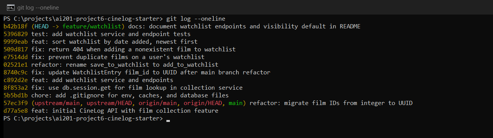

# PR Response Doc — CineLog Watchlist Feature

Responses to @dev-lead's review of the watchlist PR (`feature/watchlist` → `main`). Comments are numbered in the order they were posted.

| # | Comment | Resolution | Commit |
|---|---------|------------|--------|
| 1 | Rename `save_to_watchlist()` | Renamed to `add_to_watchlist()` | `02521e1` |
| 2 | Duplicate watchlist entries | Service check + DB constraint + 409 | `e7514dd` |
| 3 | Test for nonexistent `film_id` | Added, plus the full CONTRIBUTING test set | `5396829` |
| 4 | Default visibility `public=True` | Kept `public=True`, reasoning below | `5396829`, `b42b18f` |
| 5 | Sort by date added vs. alphabetical | Agreed — newest first | `9999eab` |
| 6 | Rebase onto UUID refactor | Rebased; UUID update in its own `fix:` commit | `8740c9c` |

---

## AI Usage

I used **Claude Code (Claude Opus 5.5)** as a pair programmer for this revision.

**What the AI did:**
- Diagnosed why `feature/watchlist` was missing from my fork (GitHub's "copy the `main` branch only" fork option, checked by default) and fetched it from the upstream repo.
- Read the review comments from the upstream PR, mapped them to code, and proposed a commit plan before writing any code.
- Ran the rebase, resolved the `models.py` conflict, and made the code changes for Comments 1, 2, 5, and 6.
- Wrote `tests/test_watchlist.py` following the existing patterns in `tests/test_collection.py`.
- Checked the final `git log --oneline` for conventional-commit format and bundled changes (details under Commit History).
- Rewrote the history. The agent's shell can't drive an interactive editor, so it ran `git rebase -i` with a scripted todo list (`GIT_SEQUENCE_EDITOR`) — the same operations (edit/split, reorder, fixup, reword, insert), without a manual editor. It kept a backup branch and verified the final tree matched the pre-rewrite tree.
- Drafted this document.

**Comments 4 and 5 (design arguments):**
- **Comment 4:** I made the decision (keep `public=True`) and asked the AI to write up the reasoning for it. It drafted the argument and the tradeoffs. As a devil's-advocate check it raised two counterpoints: (1) with no endpoint to change visibility, "public by default" currently means "public, period"; (2) "collections are already public" only shows consistency with a choice that may itself be a mistake. The first counterpoint was already covered in the tradeoffs (no opt-out endpoint yet, flag not enforced), so I kept the argument as drafted. The second I accept as a real weakness: the consistency argument holds only as long as public collections are the intended design. The position itself (public by default, for social discovery in a community app) was my choice; the wording is the AI's.
- **Comment 5:** I didn't specify a sort order, so the AI recommended agreeing with the reviewer (newest first) and drafted the argument. Its devil's-advocate counterpoint: on a long watchlist, newest-first buries older saves users never get to, which a `?sort=` parameter would address. The `?sort=title` extension was already noted in the response as the follow-up for that case. I reviewed the recommendation and accepted it as written, so this argument is the AI's draft that I agreed with, not a position I reached independently.

**What I decided / verified:**
- I chose to keep watchlists **public by default** (Comment 4).
- I accepted the AI's recommendation to sort newest first (Comment 5).
- I reviewed the plan and the commit structure, and gave the go-ahead for the rebase, history rewrite, and push.
- Verification: the full test suite was run at **every commit** in the branch (all green), and the endpoints were exercised end to end against a freshly seeded database (201 / 409 / 404 / 400 and newest-first ordering confirmed).

**Where the AI was corrected or needed checking:** It initially wrote in the README that "users can make an entry private", which isn't true yet (there's no endpoint for it); that was caught and corrected before committing. It also found a bug the review didn't mention (the route returning 500 instead of 404 for a missing film), which went in as a separate `fix:` commit.

---

## Comment 1 — Rename

> `save_to_watchlist()` should follow the project's naming convention. Compare with `add_to_collection()` — the pattern here is `verb_to_noun`. Please rename to `add_to_watchlist()` and update all call sites.

**What I did:** Renamed `save_to_watchlist()` to `add_to_watchlist()` in `services/watchlist_service.py` and updated its only call site — the import and call in `routes/watchlist/watchlist.py`. Committed on its own as `refactor: rename save_to_watchlist to add_to_watchlist` (`02521e1`) since it changes no behavior. The name now pairs with the collection API: `add_to_collection` / `add_to_watchlist`, `get_collection` / `get_watchlist`.

**Where I looked for call sites:** A project-wide search of all tracked Python files (`git grep -n "save_to_watchlist" -- '*.py'`) before the change found three hits: the definition in `services/watchlist_service.py`, and the import and the call in `routes/watchlist/watchlist.py`. `app.py` only imports the blueprint (`watchlist_bp`), not the service function, and there were no watchlist tests yet, so there were no other callers.

**How I verified:**
- The same search for `save_to_watchlist` now returns no matches; searching for `add_to_watchlist` returns only the definition, the route's import and call, and the tests.
- The app factory imports the route module, so a missed call site would break app start-up; the app starts and both `/watchlist` routes are registered.
- `pytest tests/ -v` passed at this commit, and the later watchlist tests call `add_to_watchlist()` directly.

---

## Comment 2 — Deduplication

> What happens if a user calls this with a film that's already on their watchlist? The current implementation would add a duplicate entry. Please handle this case.

**Pattern I followed — `add_to_collection()` in `services/collection_service.py`:**
1. It first looks the film up with `db.session.get(Film, film_id)` and raises `FilmNotFoundError` if it doesn't exist.
2. **The duplicate check** then queries `CollectionEntry.query.filter_by(user_id=user_id, film_id=film_id).first()`: it looks for an existing entry with the **same user *and* the same film**. The same film in another user's collection isn't a duplicate.
3. **When a duplicate is found**, it raises `AlreadyInCollectionError` (a custom exception defined in the same module) with the message `"Film '<film_id>' is already in this user's collection"`, **before** creating or adding anything. Nothing is written and nothing is returned. The route `POST /collection/<user_id>/add` catches the exception and returns **409 Conflict** with `{"error": <message>}`.
4. Only if no entry exists does it create, add, and commit the new `CollectionEntry`.
5. A database-level `UniqueConstraint("user_id", "film_id")` on `CollectionEntry` backs up the check.

**What I did:** (`e7514dd`) I applied the same pattern to the watchlist:
- `add_to_watchlist()` keeps the film-exists check, then runs `WatchlistEntry.query.filter_by(user_id=user_id, film_id=film_id).first()`. If an entry is found it raises a new `AlreadyOnWatchlistError` (`"Film '<film_id>' is already on this user's watchlist"`) before anything is written, the same way `AlreadyInCollectionError` works. The check runs after the film lookup, same as the collection version, so an unknown film still reports 404 rather than "duplicate".
- Added `UniqueConstraint("user_id", "film_id", name="unique_user_film_watchlist")` to `WatchlistEntry`, matching the constraint `CollectionEntry` already has. The service check gives callers a clear, typed error; the constraint is the backstop for anything that bypasses the service (e.g. two concurrent requests that both pass the check before either commits).
- `POST /watchlist/<user_id>/add` catches the error and returns **409 Conflict**, the same status the collection endpoint uses. I raise rather than silently returning the existing entry, to stay consistent with `add_to_collection()` and let clients tell the user "already saved".

Related bug found while testing: the route imported `FilmNotFoundError` but never caught it, so adding a nonexistent film returned a **500**. It now returns **404**, matching the collection endpoint (`509d817`, separate `fix:` commit).

**How I verified:**
- `test_add_to_watchlist_duplicate_raises` (modeled on `test_add_to_collection_duplicate_raises`) — the second add raises `AlreadyOnWatchlistError` and a count query confirms only one row exists.
- `test_add_endpoint_returns_409_for_duplicate` — the endpoint returns 201 then 409.
- Manual end-to-end run against a seeded database: second add of the same film → `409 {"error": "Film '…' is already on this user's watchlist"}`.

---

## Comment 3 — Missing test

> Please add a test for the case where `film_id` doesn't exist in the database. Look at the existing tests in `test_collection.py` — the pattern is there.

**Model test:** `test_add_to_collection_nonexistent_film_raises` in `tests/test_collection.py`. Its structure:
- it uses the `app` fixture (a fresh in-memory SQLite app per test) and the `sample_user` fixture, and deliberately **not** `sample_film`;
- inside `with app.app_context():` it uses a well-formed but unknown UUID, `"00000000-0000-0000-0000-000000000000"`;
- it asserts with `pytest.raises(FilmNotFoundError)`.

**What I did:** Created `tests/test_watchlist.py` (`5396829`) with copies of the `app`, `sample_user`, and `sample_film` fixtures from `test_collection.py`. Its `test_add_to_watchlist_nonexistent_film_raises` mirrors the model test exactly: same fixtures, same placeholder UUID, same `pytest.raises(FilmNotFoundError)` assertion, with `add_to_watchlist()` as the function under test. I added one more assertion, `WatchlistEntry.query.count() == 0`, to confirm the failed add left nothing behind. Using a valid-format UUID means the test covers "valid ID, no such film" rather than malformed input.

Because `CONTRIBUTING.md` requires happy-path, duplicate, and nonexistent-ID tests for any new service function (the original PR had none), I added the full set:

| Test | Covers |
|------|--------|
| `test_add_to_watchlist_nonexistent_film_raises` | **Comment 3** |
| `test_add_to_watchlist_creates_entry` | Happy path |
| `test_add_to_watchlist_duplicate_raises` | Comment 2 |
| `test_get_watchlist_returns_newest_first` | Comment 5 |
| `test_add_to_watchlist_defaults_to_public` | Comment 4 — locks in the visibility default |
| `test_add_endpoint_returns_404_for_nonexistent_film` | Route returns 404, not 500 |
| `test_add_endpoint_returns_409_for_duplicate` | Route returns 409 on duplicate |

**How I verified:**
- `pytest tests/test_watchlist.py -v` → 7 passed, including `test_add_to_watchlist_nonexistent_film_raises`.
- `pytest tests/ -v` → **11 passed** (4 existing + 7 new).
- Checked that the tests catch regressions rather than passing trivially: the sort-order test fails against the original alphabetical query ("Alien" sorts before "Blade Runner"), and the 404 endpoint test fails against the original route, which returned 500.

---

## Comment 4 — Default visibility

> I notice watchlists default to `public=True`. We don't have a documented decision on default visibility for user lists. Before I can approve this, I need you to add a note to your PR description explaining your reasoning.

**My position:** Keep `public=True` as the default — intentionally, not inherited.

**Reasoning:**
1. **It matches what CineLog is for.** CineLog is a *community* film tracking app. A watchlist's value in a community setting is social: seeing what friends plan to watch, finding people with overlapping taste, recommending a film someone has already saved. Most users never change defaults, so a private default would quietly remove that value for nearly everyone.
2. **It's consistent with how the app already treats user lists.** The existing collection (`GET /collection/<user_id>`) — which includes users' *ratings* — is already readable by anyone with the user ID. A list of films someone *wants* to watch is lower-sensitivity than that. Making watchlists stricter than collections would be inconsistent without a specific reason.
3. **The opt-out is per entry.** The flag lives on each `WatchlistEntry`, so once a toggle exists a user can hide a single film without hiding their whole list.

**Tradeoff acknowledged:**
- **Privacy-conscious users are exposed by default.** Someone who doesn't want others to see their list has to act — and right now they *can't*, because there's no endpoint to change `public`. A `PATCH /watchlist/<user_id>/<film_id>` (or a per-user default setting) should follow before watchlists are promoted as a social feature.
- **The flag isn't enforced yet.** CineLog has no authentication, so `GET /watchlist/<user_id>` returns every entry regardless of `public`. When auth lands, the endpoint must return only public entries to anyone other than the owner.
- **Public is the harder default to walk back.** Flipping public → private later is safe; flipping private → public would expose data users assumed was hidden. If watchlists ever gain more sensitive data (e.g. free-text notes), that should be revisited and defaulted to private.

Documented in the PR description below, in the `WatchlistEntry` entry in `README.md` (`b42b18f`), and enforced by `test_add_to_watchlist_defaults_to_public`, which fails if the default changes without the decision being updated.

---

## Comment 5 — Sort order

> I'd prefer watchlists to default to "date added" order rather than alphabetical. Most users want to see what they added recently. I'm open to discussion if you see it differently — but let's make a decision and document it.

**My position:** Agree — `get_watchlist()` now returns entries by `date_added` descending, newest first (`9999eab`).

**Reasoning:**
1. **Consistency with the rest of the API.** `get_collection()` already returns newest first. Two list endpoints in the same app ordering differently would surprise both users and client developers.
2. **Alphabetical is cheap to get elsewhere; recency isn't.** Any client can sort a returned list by title locally. The server should provide the less obvious, more useful default.
3. **Simpler query.** The old version joined `Film` only to sort by title; ordering by `WatchlistEntry.date_added` removes the join.

**Engagement with reviewer's point:** I took the case for alphabetical seriously before agreeing: when someone opens a watchlist to *pick* something to watch, they're browsing, and a catalog-style A–Z list supports scanning. But the reviewer's point about intent is stronger — people add to a watchlist right after hearing about a film (a trailer, a friend's recommendation), and the thing they most often look for is what they just saved. Alphabetical order buries a fresh addition in the middle of the list. The browsing use case is still served, because clients can re-sort by title. If users ask for server-side alphabetical later, the clean extension is an optional `?sort=title` parameter with newest-first as the default; I left that out to keep this PR scoped to the review. Locked in by `test_get_watchlist_returns_newest_first`.

---

## Comment 6 — Rebase

> A refactor merged to `main` that changed film IDs from integers to UUIDs. Your watchlist code still references integer IDs. Please rebase on `main` and update accordingly.

**What conflicted:** `git rebase main` stopped on the original watchlist commit with a conflict in `models.py`, on `WatchlistEntry.film_id`:

```diff
<<<<<<< main
    film_id = db.Column(db.String(36), db.ForeignKey("film.id"), nullable=False)
=======
    film_id = db.Column(db.Integer, db.ForeignKey("film.id"), nullable=False, index=True)
>>>>>>> watchlist
```

Main changed the column type to a UUID string; my branch had added an index to the same line. Neither side alone was right — main's side drops the index, and my side reintroduces an integer foreign key pointing at a string primary key.

**How I resolved it:** The correct line combines both sides: `db.String(36)` from main (it must match `Film.id` for the foreign key to be valid) **plus** `index=True` from my branch (watchlist lookups filter by `film_id`). Git only flags lines that conflict textually, so I also searched the watchlist code for other integer assumptions and found two stale docstrings: `film_id (int): ID of the film` in `add_to_watchlist()` and `Body: { "film_id": <int> }` on the add route. Both now describe UUID strings.

Resolving a conflict mid-rebase folds the resolution into the commit being replayed, which would hide the UUID work inside the feature commit. To keep it visible and reviewable, the UUID update is its own commit:

- `c892d2e feat: add watchlist service and endpoints` — the watchlist code as originally reviewed (integer `film_id`).
- `8740c9c fix: update WatchlistEntry film_id to UUID after main branch refactor` — `db.Integer` → `db.String(36)` on `WatchlistEntry.film_id` (index kept), plus the two docstrings.

**How I verified no conflict remains:**
- No conflict markers remain in any file (`grep` for `<<<<<<<` / `>>>>>>>` finds nothing), and the rebase completed.
- `git fetch origin` followed by `git rebase origin/main` reports "Current branch feature/watchlist is up to date", so the branch is on top of the latest `main`.
- `git log --merges origin/main..feature/watchlist` returns nothing — the history is linear, as `CONTRIBUTING.md` requires.
- No integer film-ID references remain in the watchlist code (`git grep -n "Integer\|(int)\|<int>"` only matches unrelated columns such as `Film.year` and `CollectionEntry.rating`).
- The full test suite passed at every commit, using UUID film IDs throughout, and an end-to-end run against a freshly seeded database returned UUID `film_id`s from the watchlist endpoints.

Note for local testing: `db.create_all()` doesn't alter existing tables, so a `cinelog.db` created before this PR won't have the UUID column types or the new unique constraint. Delete it and re-run `python seed.py`.

---

## Commit History

Rewritten with interactive rebase to conventional commits, one logical change each. Every commit passes the test suite on its own.



```
b42b18f docs: document watchlist endpoints and visibility default in README
5396829 test: add watchlist service and endpoint tests
9999eab feat: sort watchlist by date added, newest first
509d817 fix: return 404 when adding a nonexistent film to watchlist
e7514dd fix: prevent duplicate films on a user's watchlist
02521e1 refactor: rename save_to_watchlist to add_to_watchlist
8740c9c fix: update WatchlistEntry film_id to UUID after main branch refactor
c892d2e feat: add watchlist service and endpoints
8f853a2 fix: use db.session.get for film lookup in collection service
5b5bd1b chore: add .gitignore for env, caches, and database files
57ec3f9 refactor: migrate film IDs from integer to UUID
d77a5e8 feat: initial CineLog API with film collection feature
```

**Format check.** I gave this log to an AI and asked: "Do these commit messages follow conventional commit format? Are any messages bundling multiple logical changes that should be separate commits?" I then checked its answer against the Conventional Commits spec and the prefix table in `CONTRIBUTING.md`:
- Every message has a valid type from `CONTRIBUTING.md` (`chore`, `fix`, `feat`, `refactor`, `test`, `docs`), a lowercase imperative description, and no trailing period.
- The rename is `refactor:`, not `fix:` as in the sample history, because `CONTRIBUTING.md` defines `refactor:` as "code restructuring with no behavior change", which is exactly what a rename is.
- Possible bundling flagged and kept on purpose: `fix: prevent duplicate films…` touches the service, the model, and the route, but they're one change (dedup enforced at each layer) and splitting them would leave commits where the route can't handle the new error. `test: add watchlist service and endpoint tests` covers several behaviors, but they're the test suite for one new module, which `CONTRIBUTING.md` treats as one unit.
- No "WIP"/"more changes"-style messages and no merge commits remain.

What changed from the original two commits:

| Original | Problem | Became |
|----------|---------|--------|
| `added watchlist model and endpoint fixed a bug more changes` | No type prefix; several changes in one message | `feat: add watchlist service and endpoints` |
| `fix: update film retrieval method to use db.session.get in collection and watchlist services` | Mixed an unrelated collection-service fix with fixes to the unmerged watchlist code (including a broken `from routes.watchlist import watchlist_bp` import) | Split: the collection change became its own `fix:` commit; the watchlist parts were squashed into the `feat:` commit they were fixing |

The UUID update for Comment 6 was split out of the feature commit into its own `fix:` commit, and each review fix is a separate commit, so every comment maps to a reviewable change. `pr-response.md` itself is added in a final `docs:` commit on top of this history. A `chore:` commit adding a `.gitignore` (virtualenv, Python caches, SQLite database, `.env`) sits at the base of the branch so none of those files can end up in the history; I confirmed none had been committed before adding it.

---

## PR Description

### What this does
Adds a watchlist so users can save films they want to watch later, separate from their collection of films they've already watched. Users add a film with `POST /watchlist/<user_id>/add` and view their list with `GET /watchlist/<user_id>`; adding a film twice returns 409, and adding a film that doesn't exist returns 404.

### Design decisions
- **Watchlists are public by default** (`public=True`), because CineLog is a community app and a watchlist's value is largely social; this is consistent with collections, which are already readable by user ID. The flag is per entry. It isn't enforced yet (no auth) and isn't user-editable yet — both are follow-ups. Full reasoning in Comment 4.
- **Sorted newest first** by `date_added`, matching `get_collection()` and reflecting that users mostly look for what they just saved. Full reasoning in Comment 5.
- **Duplicates are rejected** (409) rather than silently ignored, matching `add_to_collection()`, with a DB unique constraint as a backstop.
- **Film IDs are UUID strings**, following the refactor on `main`.

### How to test manually
```bash
rm -f cinelog.db                 # old DBs predate the UUID/unique-constraint schema
pip install -r requirements.txt
python seed.py                   # prints the demo user_id
python app.py
```
In another terminal (replace `<user_id>` and `<film_id>`; get film IDs from `GET /films/`):
```bash
curl http://localhost:5000/films/
curl -X POST http://localhost:5000/watchlist/<user_id>/add \
     -H "Content-Type: application/json" -d '{"film_id": "<film_id>"}'          # 201
curl -X POST http://localhost:5000/watchlist/<user_id>/add \
     -H "Content-Type: application/json" -d '{"film_id": "<film_id>"}'          # 409
curl -X POST http://localhost:5000/watchlist/<user_id>/add \
     -H "Content-Type: application/json" \
     -d '{"film_id": "00000000-0000-0000-0000-000000000000"}'                   # 404
# add a second film, then:
curl http://localhost:5000/watchlist/<user_id>    # most recently added first, "public": true
```
Automated: `pytest tests/` → 11 passed.
